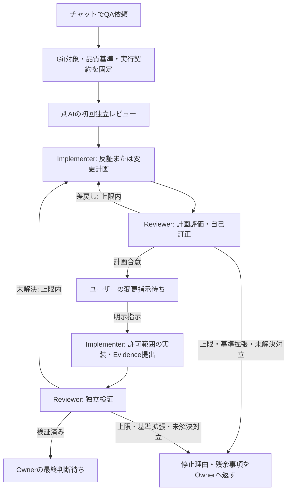

# 別AIによるQAオーケストレーション変更計画

作成日: 2026-11-12 / 作成: Codex
状態: 合意内容を文書化した初稿。実装未着手。
作業ブランチ: `plan/qa-agent-orchestration`
調査基準HEAD: `5132c610011bd9aa02bfe4c4cb12d0ac0d83fe2c`

## 1. 目的と今回の作業範囲

チャットでQAを依頼すると、作成側がGit上の対象・品質基準を固定し、別AIへCLI主体で自動依頼し、結果を自動受領する。ImplementerとReviewerの応答を中央で管理し、誤指摘への反証、計画合意、別途の実装許可、実装後の独立検証まで追跡できるLoopを作る。

今回承認されている作業は、調査、計画設置、falsify-meによる計画の自己点検と必要な計画修正。製品実装、Skillの外部配置、mainへの統合は後工程である。内容の合意を実装開始許可に読み替えない。

開発正本はこのqa-products。Productivity-Skillは検証済み成果物の配布先とする。起点側のProductivity-Skillブランチ`plan/qa-skill-independent-review`には本件のファイル変更を作成していない。

## 2. 対話で合意した判断

| ID | 判断 |
| --- | --- |
| D01 | QA関係Skill全体を調査し、役割分担と変更計画を整理する。 |
| D02 | quality-qaがAI起動、受渡し、状態、回数、停止条件を中央制御する。 |
| D03 | Implementerはquality-response、Reviewerはquality-reviewに準じるRoleを持つ。 |
| D04 | 通常Reviewerは1人。事前定義したリスク条件に該当する場合に2人目を自動起動する。 |
| D05 | 作成側と別AIを原則とする。このUbuntuではCodex⇔OpenCode。自宅ではCodex、Claude Code、Cursor、Antigravityを利用する想定。 |
| D06 | OpenCodeはGPT-5.4 xHigh固定。費用は部門負担であり無料モデルという意味ではない。 |
| D07 | 同一モデル・別ハーネスは実行分離として記録し、モデル多様性を保証したと言わない。 |
| D08 | 初回Reviewerに作成側の自己評価やチャット履歴を渡さない。目的・基準・対象SHA・必要Evidenceは渡す。 |
| D09 | 2人の場合は最初は互いの所見を見せず、その後に根拠付きで相互確認する。多数決でFindingを消さない。 |
| D10 | Implementerは指摘へ反証または変更計画を提出し、Reviewerと合意してから実装候補とする。 |
| D11 | 計画合意とユーザーによる製品変更の承認指示は別。後者がなければ製品を変更しない。 |
| D12 | 計画協議と修正後検証を通算して最大3往復。解消しない不一致はOwnerへ戻す。 |
| D13 | 元の目的・受入基準・対象範囲の拡張を必須化する場合は停止してOwnerへ戻す。範囲外改善案は分離する。 |
| D14 | spec-driven-qa-reviewの接続設計、blind-qa-cycleのGit/Web QA連携は中核Loopを固めた後に検討する。 |

## 3. 現状と役割の再配置

| 対象 | 調査で確認した状態 | 本計画での扱い |
| --- | --- | --- |
| quality-loop/skills/quality-qa | 通常QA依頼・結果取込・承認済修正・再QAのworkflow。formal caseとは別管理 | オーケストレーターへの拡張候補。状態正本の選択を先に設計する |
| quality-review | formal caseのreview、review-plan、verify、assess-risk | ReviewerのRole境界を維持して中央制御へ接続 |
| quality-response | formal caseのsubmit-plan、submit-response | ImplementerのRole境界を維持して中央制御へ接続 |
| spec-review-loop | OpenSpec基準固定、独立Reviewer CLI、worktree、ログ、Gate、停止判定。Codex/Cursor/Claudeアダプタを持つ | CLI起動・隔離・監視の再利用候補。OpenCode接続と計画合意工程は追加設計が必要 |
| blind-qa-cycle | 固定SHA監査、Git/Web QA依頼と成果物の受渡し | 中核Loop完了後の接続候補。今回変更しない |
| spec-driven-qa-review | グローバル配置にPurpose/Spec/Plan/実装/Evidence照合と複数サイクル管理がある | 後続の専門レビュー方式候補。正本・退役経緯を確認してから接続判断 |

根拠: `quality-loop/README.md`、各`skills/*/SKILL.md`、`spec-review-loop/runtime/spec_review_loop/reviewers.py`、`quality-loop/quality_loop/engine.py`。グローバル配置のSkillは現行正本と同一とは限らない。

確認したformal runtimeでは、submit-plan→review-plan→submit-response→verifyの骨格がある。cycle_countはverifyで増え、計画差戻しは加算されない。3往復の全体上限には追加の制御が必要。

## 4. 目標フロー

指摘0件でも確認範囲・Evidence・未検証事項を返す。ReviewerのPASSや計画合意を、Ownerによる受入・リスク受容・リリース許可へ自動変換しない。

## 5. 中央制御の設計要件

### 5.1 Gitと受渡し

依頼にPurpose、全受入基準の安定ID、対象path、baseline/reviewedの完全SHA、必須check、Reviewer契約の版・hashを固定する。dirtyな作業ツリーと無関係な変更を保持する。Reviewerは固定SHAの隔離worktreeを読み、製品変更権限を持たない。確認コマンドは許可されたcheck契約で実行し、静的レビューと実行Evidenceを区別する。

依頼・返却にはrequest/case ID、revision、handoff、対象SHA、Role、実行主体、モデル指定と観測できた実モデル、結果・Evidenceを結び付ける。結果取込は対象版・契約・構造を照合する。AIが形式上正しいJSONを返したことだけで内容確認済みにしない。

### 5.2 応答・計画・許可

Implementerは反証Evidenceを提出でき、Reviewerは撤回や改善提案への変更ができる。コード修正するFindingには計画合意と別途ユーザー許可を必要とする。既存runtimeの軽微Finding向け直接submit-response経路と整合させる。

### 5.3 往復上限と停止

計画協議と実装後検証を通算して最大3往復。2人Reviewer、失敗再試行、再開時にも上限を維持する。基準拡張、対象版の不一致、結果の改変、計画不合意、接続不能、上限到達は状態として残す。上限を隠れてリセットした新規依頼で自動再開しない。

### 5.4 実行先と独立性

AI実行先を差し替え可能なアダプタにする。初期実用経路はこのUbuntuのCodex⇔OpenCode。Claude Code/Cursorは自宅用の既存アダプタを再評価し、Antigravityは作成側としての起動・引継ぎ契約を調査する。コマンドの存在だけで認証、モデル可用性、tool call、権限制約の動作を確認済みと言わない。

サブエージェントQAも、別CLIプロセスとの比較対象として、履歴共有、モデル、権限、対象固定、実行記録を評価する。API呼出しだけでソースやGitを確認できると仮定しない。

### 5.5 リスクと2人Reviewer

Ownerが事前に定義するリスク条件を中央制御が適用し、適用条件・根拠・設定版を記録する。通常は1人。高リスク条件で2人。曖昧な場合は通常1人とし、評価の不確実性と追加レビュー推奨を記録する。不明を低リスクと判定したことにはしない。

2人の初回結果を保存してから相互確認する。異なる見解と根拠を保持し、未解決対立はOwnerへ戻す。

## 6. 段階とタスク

| タスク | 内容・成果物 | 完了条件 |
| --- | --- | --- |
| T01 | 現行3 workflowの状態・成果物・権限と配布版との差分を一覧化する | quality-qa、formal Quality Loop、spec-review-loopの責務と重複を根拠path付きで特定 |
| T02 | 状態正本、Role橋渡し、往復・停止・承認の契約を設計する | 二重状態更新の扱い、具体的な正常/停止トレース、再開条件を明文化 |
| T03 | OpenCode固定モデルとCodex CLIの最小接続実験を設計・実施する | 両方向の固定SHAレビュー・返却・権限制約・実モデル/effort Evidenceを確認。不可能なら不足条件を明示 |
| T04 | OpenSpec changeへ本計画を具体化する | 要求、設計、tasks、受入例を相互リンクし、実装開始判定を記録 |
| T05 | 中央状態制御・アダプタ・自動依頼/受領を実装する | 下記受入シナリオの実装・意味のある回帰確認が成立 |
| T06 | 計画合意・別途実装許可・3往復上限を接続する | 誤指摘撤回、差戻し、許可待ち、再開、上限停止が記録と一致 |
| T07 | 2人Reviewerとリスク条件を接続する | 条件判定根拠、独立初回、相互確認、対立停止を確認 |
| T08 | 別AIによる独立QAと引継ぎ文書を整える | 指摘対応と再確認Evidenceを保存。自己点検を独立QAに数えない |
| T09 | 配布候補と後続接続課題をまとめる | 外部配置は別途指示。blind/spec-driven接続を後続として整理 |

次の作業はT01→T02。現在は全タスク未実施。T03以降の実行実験・実装の許可境界は再開ガイドで示す。

## 7. 受入シナリオ

1. CLI経由で別AIへ依頼し、手作業の貼付けなしで結果を保存・内容照合できる。
2. 誤指摘へEvidenceで反論でき、Reviewerの撤回を記録できる。
3. 計画差戻し時と、Reviewer合意後のユーザー許可待ちでは製品を変更しない。
4. 計画協議と修正後検証を合算し、3往復を超えて自動起動しない。
5. 基準の必須拡張、対象SHA違い、結果不正、Reviewer不能は成功に補完せず理由付きで止まる。
6. 中断再開・再試行・2人Reviewerでも、過去記録・上限・許可範囲が保持される。
7. 元の作業ツリーの無関係な差分、既存認証・LLM設定を保持する。
8. 同一モデル別実行と別モデルでの評価を区別して報告する。

## 8. 未解決事項と判断責任

状態正本の選択、全体往復の厳密な計数、2人時の計画合意条件、OpenCodeの実モデル識別子・xHigh指定と実効権限、リスク条件の具体値、実装許可の有効範囲と再承認条件はT01〜T04で決定する。現時点で実装準備完了とは判定しない。

Ownerは基準、製品変更許可、未解決対立と残余リスクを判断する。オーケストレーターは固定基準と許可に従う。Reviewerや多数決がOwnerの権限を代替しない。

## 9. 次セッションへの入口

再開手順は[再開ガイド](qa_agent_orchestration_next_20261112.md)。本計画を一度保存した後、falsify-meで点検し、指摘と修正を別記録へ残す。今回は実装・外部AI呼出しを実施していない。
